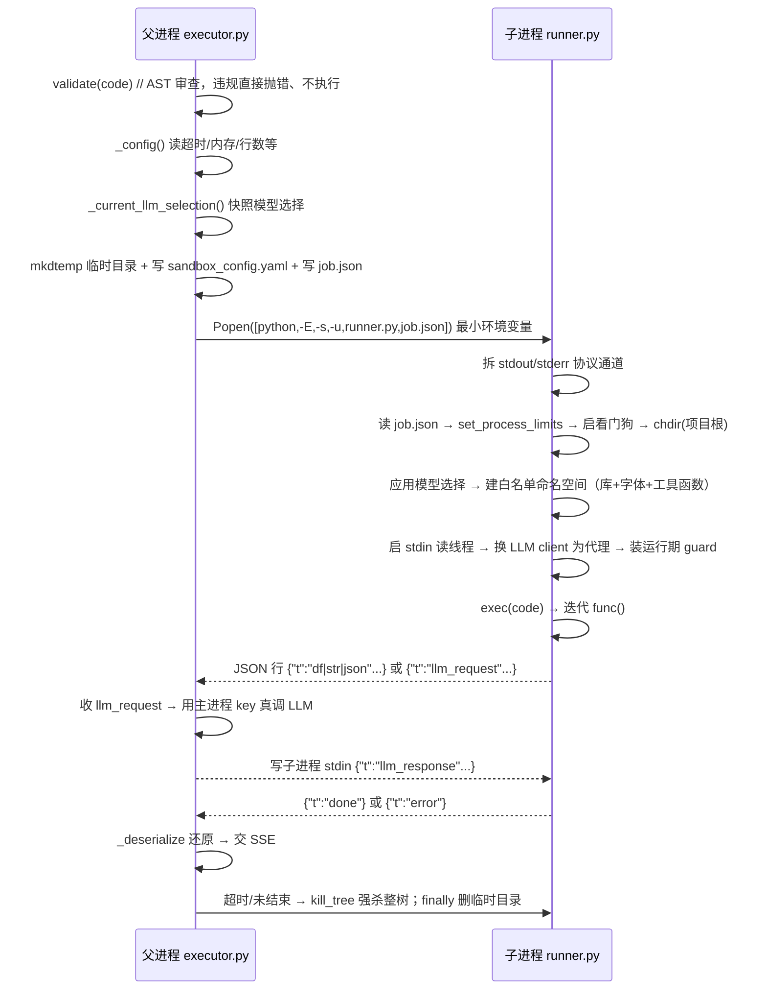

# 代码执行沙箱：功能与实现说明

本文描述"LLM 生成的 Python 代码"这条执行链的**功能与实现**：主进程（父）如何准备并启动
一次性子进程，子进程在 `exec` 生成代码**之前**初始化了什么，执行如何回传结果、如何收尾。
每步都引用关键代码行（行号以当前修订为准）。

涉及文件：

- 父：`agent/tools/copilot/utils/sandbox/executor.py`
- 子：`agent/tools/copilot/utils/sandbox/runner.py`
- 辅助：`sandbox/policy.py`、`sandbox/limits.py`、`sandbox/guard.py`（运行期文件/网络 audit hook）
- 配置/依赖：`config/sandbox.yaml`（`config/sandbox_config.py` 加载）、`config/get_config.py`、
  `agent/tools/tools_def.py`、`data_access/db_conn.py`、`data_access/sys_db_conn.py`、
  `agent/utils/llm_access/LLM.py`

---

## 一、功能概述

代码执行沙箱把 LLM 生成的 Python 代码放进一个**一次性子进程**运行，主进程只负责审查、
下发、收口和回收，从而把"跑飞的代码"（崩溃、死循环、内存炸弹、GUI 阻塞、库状态污染）
限制在子进程内。核心能力：

| 能力 | 实现 |
|---|---|
| 先审查后执行 | `policy.py` 的 AST 白名单审查，违规不执行 |
| 进程隔离 | 每次执行 spawn 一个子进程，跑完即毁 |
| 能力最小化 | 子进程只有只读库身份；无特权库、无 `os`、无项目特权模块 |
| 白名单命名空间 | `exec` 的 globals 手工构造，只含预置库与工具函数 |
| 资源限制 | 超时强杀整树；内存/CPU/进程/文件大小上限 |
| 窄输出通道 | 结果只经 stdout 的 JSON-lines 协议回传 |
| 模型选择继承 | 子进程还原父请求选中的模型/Depth/Style |
| 数据回传 | DataFrame 转 CSV 传回，主进程还原 |
| 惰性启动 | 调用方开始迭代才 spawn；迭代结束即强杀 |

---

## 二、执行链路总览



---

## 三、父进程：准备、启动与收尾（`executor.py`）

### 3.1 先审查，绝不执行违规代码

```python
# executor.py:207-230
def execute_in_sandbox(code):
    try:
        violations = validate(code)           # policy.py:134
    except PolicyViolation as exc:
        raise SandboxError("...rejected...", kind=getattr(exc, "kind", "policy_violation"))
    if violations:
        raise SandboxError("...rejected...\n{bullets}...", kind="policy_violation")
    return _iter_items(code)                  # 返回生成器，惰性启动子进程
```

- 审查在**主进程**做，违规直接抛 `SandboxError`，子进程根本不起。
- 返回生成器：**调用方开始迭代时才 spawn**，迭代提前结束也会走 `finally` 杀掉子进程。

### 3.2 读取限值

```python
# executor.py  限值取自 config/sandbox.yaml（代码内不写默认值）
from config.sandbox_config import get_section
def _config():
    code_exec = get_section("code_exec")
    # 缺必需键 → SandboxError(kind="config_error")
    return {"timeout": float(code_exec["timeout"]),
            "max_memory_mb": int(code_exec["max_memory_mb"]),
            "cpu_seconds": int(code_exec["cpu_rate"]),
            "max_processes": int(code_exec["max_processes"]),
            "max_file_mb": int(code_exec["max_file_mb"]),
            "max_df_rows": int(code_exec["max_df_rows"]),
            "max_line_mb": int(code_exec["max_line_mb"])}
```

```python
# config/get_config.py:15  子进程配置路径由环境变量决定（主进程不设它）
_CONFIG_PATH = os.environ.get("CODE_EXEC_CONFIG") or <项目>/config/config.yaml
```

### 3.3 生成任务描述 job（含模型选择快照）

```python
# executor.py:81-105  快照当前请求选中的模型/Depth/Style
def _current_llm_selection():
    try:
        from agent.utils.llm_access.LLM import (
            get_current_model_id, get_current_reasoning_effort,
            get_current_style, get_current_use_images,
        )
        return {"model": get_current_model_id(),
                "reasoning_effort": get_current_reasoning_effort(),
                "style": get_current_style(),
                "use_images": get_current_use_images()}
    except Exception:
        return {}
```

```python
# executor.py:233-247
def _iter_items(code):
    cfg = _config()
    job = {"code": code, "project_root": str(_PROJECT_ROOT),
           "max_df_rows": cfg["max_df_rows"], "max_line_mb": cfg["max_line_mb"],
           "llm_selection": _current_llm_selection(),
           "limits": {"max_memory_mb": ..., "cpu_seconds": ...,
                      "max_processes": ..., "max_file_mb": ...}}
```

### 3.4 临时目录、最小沙箱配置与 job 文件

```python
# executor.py:249-258
    workdir = tempfile.mkdtemp(prefix="code_sandbox_")   # 系统临时目录，如 %TEMP%\code_sandbox_xxxx
    try:
        sandbox_config_path = _render_sandbox_config(workdir)
    except Exception:
        _cleanup(workdir); raise
    job_path = os.path.join(workdir, "job.json")
    err_path = os.path.join(workdir, "stderr.log")
    with open(job_path, "w", encoding="utf-8") as handle:
        json.dump(job, handle, ensure_ascii=False)
```

```python
# executor.py:123-156  最小沙箱配置：只有工具真正会读的三项，绝不含特权库
    data = {
        "mysql_readonly": config_data.get("mysql_readonly") or "",
        "static_path": config_data.get("static_path", ""),
        "llm_models": config_data.get("llm_models") or [],
    }
    path = os.path.join(workdir, "sandbox_config.yaml")
    ... yaml.safe_dump(data, ...)      # 写失败即中止（fail-closed），不回退特权 config.yaml
```

### 3.5 最小环境变量与启动命令

```python
# executor.py:108-120  环境变量白名单 + CODE_EXEC_CONFIG 指向最小配置
_ENV_ALLOW = ("PATH", "PATHEXT", "SYSTEMROOT", "SystemRoot", "WINDIR", "COMSPEC",
              "TEMP", "TMP", "TMPDIR", "HOME", "USERPROFILE", "APPDATA", "LOCALAPPDATA", ...)
def _build_env(sandbox_config_path):
    env = {k: os.environ[k] for k in _ENV_ALLOW if k in os.environ}
    env["MPLBACKEND"] = "Agg"
    if sandbox_config_path:
        env["CODE_EXEC_CONFIG"] = str(sandbox_config_path)
    return env
```

```python
# executor.py:260-286
    command = [sys.executable, "-E", "-s", "-u", str(_RUNNER), job_path]  # -E 忽略PYTHON*；-s 无user site；-u 无缓冲
    popen_kwargs = dict(cwd=str(_PROJECT_ROOT), env=_build_env(sandbox_config_path),
                        stdin=subprocess.PIPE, stdout=subprocess.PIPE, stderr=err_handle)
    if IS_WINDOWS:
        popen_kwargs["creationflags"] = subprocess.CREATE_NEW_PROCESS_GROUP
    else:
        popen_kwargs["start_new_session"] = True
    job_object = WindowsJob(cfg["max_memory_mb"]) if IS_WINDOWS else None
    sink = queue.Queue()
    proc = subprocess.Popen(command, **popen_kwargs)
    if job_object is not None:
        job_object.assign(proc.pid)
    reader = threading.Thread(target=_pump, args=(proc.stdout, sink), ...); reader.start()
```

- stdout（PIPE）承载 JSON-lines 协议；stderr 重定向到 `stderr.log`；**stdin 为 PIPE**，承载父进程对 LLM 代理请求（`llm_response`）的回写。
- 进程分组：Windows 用 Job Object（内存上限 + kill-on-close + 整树终止）；POSIX 用新会话，便于 `killpg`。

### 3.6 读取协议（deadline + 分类）

```python
# executor.py:288-313
        deadline = time.monotonic() + cfg["timeout"]
        while True:
            remaining = deadline - time.monotonic()
            if remaining <= 0: raise SandboxError(_timeout_message(cfg, err_path), kind="timeout")
            kind, raw = sink.get(timeout=remaining)
            if kind == "eof": break
            message = _decode(raw)
            if message is None: continue
            if message.get("t") == "llm_request":   # LLM 代理：父进程用 key 真调，回写 stdin
                _write_child(proc, _handle_llm_request(message)); continue
            if message.get("t") == "error":      # 子进程报错 → 附 stderr tail 抛出
                raise SandboxError(msg, kind=message.get("kind") or "runtime_error")
            if message.get("t") == "done": finished = True; break
            yield _deserialize(message)          # 解析好的结果逐条交给上层 SSE
```

**LLM 代理（父进程侧）**：子进程内所有 LLM 调用不真连 API，而是把请求经协议通道回传；父进程在
读循环里用**自己内存里的 key** 完成调用并回写：

```python
# executor.py
def _handle_llm_request(message):        # 父进程持有 key
    payload = message.get("payload") or {}
    resp = get_llm_dynamic().chat.completions.create(**payload)
    return {"t": "llm_response", "id": message.get("id"), "ok": True,
            "content": resp.choices[0].message.content}

def _write_child(proc, obj):             # 写回子进程 stdin
    proc.stdin.write((json.dumps(obj, ensure_ascii=False) + "\n").encode("utf-8"));
    proc.stdin.flush()
```

```python
# executor.py:315-321  子进程未发结束消息就退出 → 视为被资源限制杀掉/崩溃，报错走重试
        if not finished:
            raise SandboxError(_unexpected_exit_message(proc, err_path), kind="resource_limit")
```

### 3.7 结果还原与收尾

```python
# executor.py:181-191  还原：DataFrame 由 CSV 还原
def _deserialize(message):
    kind = message.get("t")
    if kind == "df":
        return pd.read_csv(io.StringIO(message.get("v", "")), index_col=0)
    if kind == "json": return message.get("v")
    return message.get("v", "")
```

```python
# executor.py:322-337  无论成功/异常/超时：杀进程树、关 Job、关文件、删临时目录
    finally:
        if proc is not None and proc.poll() is None:
            kill_tree(proc.pid, job_object)
            try: proc.wait(timeout=10)
            except Exception: pass
        if job_object is not None: job_object.close()
        if proc is not None and proc.stdout is not None: proc.stdout.close()
        err_handle.close()
        _cleanup(workdir)      # shutil.rmtree(workdir, ignore_errors=True)
```

---

## 四、子进程：启动与 `exec` 前初始化（`runner.py`）

### 4.1 进程入口

```python
# runner.py:22-31  让 sandbox 目录与项目根可 import；matplotlib 后端必须在导入前设
_HERE = os.path.dirname(os.path.abspath(__file__))
sys.path.insert(0, _HERE)
_PROJECT_ROOT = os.path.abspath(os.path.join(_HERE, *([os.pardir] * 5)))
sys.path.insert(0, _PROJECT_ROOT)
os.environ["MPLBACKEND"] = "Agg"
```

```python
# runner.py:187-215  main()
def main(argv):
    _PROTOCOL = _setup_protocol()                     # ① 拆协议通道
    with open(argv[1], ...) as handle: job = json.load(handle)   # ② 读 job.json
    limits = job.get("limits") or {}
    import limits as _limits
    _limits.set_process_limits(...)                   # ③ POSIX rlimit
    _limits.start_orphan_watchdog()                   # ④ 孤儿看门狗
    cwd = job.get("project_root")
    if cwd and os.path.isdir(cwd): os.chdir(cwd)      # ⑤ 切工作目录
    _execute(job)
```

```python
# runner.py:36-49  ① 协议通道与用户输出分离
def _setup_protocol():
    fd = os.dup(1)          # 保留原 stdout 用于协议
    os.dup2(2, 1)           # fd1 指向 stderr：生成代码的 print/库告警都进 stderr
    ...
    return os.fdopen(fd, "w", encoding="utf-8", buffering=1, newline="\n")
```

```python
# limits.py:52-67  ③ 逐项设限，不支持的平台跳过
    if max_memory_mb: _apply_rlimit(resource.RLIMIT_AS, int(max_memory_mb) * 1024 * 1024)
    if cpu_seconds:   _apply_rlimit(resource.RLIMIT_CPU, int(cpu_seconds))
    if max_processes: _apply_rlimit(resource.RLIMIT_NPROC, int(max_processes))
    if max_file_mb:   _apply_rlimit(resource.RLIMIT_FSIZE, int(max_file_mb) * 1024 * 1024)
```

### 4.2 `exec` 之前，子进程实际初始化的一切（重点）

**（a）应用模型选择（写回 contextvar）**

```python
# runner.py:140-160
def _apply_llm_selection(selection):
    if not isinstance(selection, dict): return
    try:
        from agent.utils.llm_access.LLM import apply_request_selection
        apply_request_selection(selection.get("model"), selection.get("reasoning_effort"),
                                selection.get("style"), selection.get("use_images"))
    except Exception as exc:
        print(f"[sandbox] WARNING: failed to apply LLM selection: {exc}", flush=True)
```

```python
# runner.py:163-169  _execute 开头，exec 之前
    _apply_llm_selection(job.get("llm_selection"))
    namespace = _build_namespace()
```

> 模型选择存在 contextvar（`LLM.py:101`、`184-185`）；contextvar **不跨进程**，故需在子进程
> 里用 job 里的值重设。`apply_request_selection` 是同一份函数，父进程由 HTTP 中间件调用、
> 子进程由 `runner` 调用。

**（b）预导入库并绑定到命名空间**

```python
# runner.py:87-104
def _build_namespace():
    import datetime as _datetime, json as _json, math, re as _re
    import matplotlib, matplotlib.pyplot as plt, numpy as np, pandas as pd, PIL, seaborn as sns
    namespace = {"pd": pd, "np": np, "plt": plt, "sns": sns, "PIL": PIL,
                 "math": math, "json": _json, "re": _re, "datetime": _datetime,
                 "matplotlib": matplotlib}
```

**（c）中文字体 + 禁用 GUI 阻塞**

```python
# runner.py:106-117
    try:
        from agent.tools.copilot.utils.mpl_chinese_font import setup_chinese_font
        setup_chinese_font()
    except Exception: pass
    try:
        plt.show = lambda *args, **kwargs: None
    except Exception: pass
```

**（d）加载工具函数（触发 import 副作用，把"连接对象/配置"也建好）**

```python
# runner.py:119-135
    try:
        from agent.tools.get_function_info import FUNCTION_DICT
        namespace.update(FUNCTION_DICT)              # exe_sql/load_data/explain_data/地图/predict_hdb_price...
    except Exception as exc:
        _emit({"t": "error", "kind": "environment_error", "msg": f"failed to load tool functions: {exc}"})
    try:
        from agent.tools import tools_def
        for name in ("exe_sql", "load_data", "explain_data", "get_save_image_path",
                     "exe_mcp", "search_web", "fetch_webpage"):
            func = getattr(tools_def, name, None)
            if func is not None: namespace.setdefault(name, func)
    except Exception: pass
```

上述 import 的**副作用**（`exec` 前发生，按沙箱配置建好对象，但不等于已建立连接）：

```python
# tools_def.py:27-49  数据库引擎：只读账号来自沙箱配置；无 mysql 时 engine=None
READONLY_DATABASE_URL = config_data.get('mysql_readonly') or ""
if READONLY_DATABASE_URL:
    read_engine = sqlalchemy.create_engine(READONLY_DATABASE_URL, pool_size=20, ...)
else:
    read_engine = None
read_only_engine = read_engine if read_engine is not None else engine
```

```python
# data_access/db_conn.py:9-19   沙箱配置没有 'mysql' → 特权 engine = None
engine = create_engine(config_data.get('mysql'), ...) if config_data.get('mysql') else None
# data_access/sys_db_conn.py   同理：无 'mysql_sys' → sys_engine = None
```

```python
# LLM.py:54-72   模型清单来自沙箱配置；工具用的是代理，本身不含模型
def _build_model_configs(): ...        # 读 config_data["llm_models"]
MODEL_CONFIGS = _build_model_configs()
# tools_def.py:54
llm = get_llm_dynamic()                # DynamicLLM 代理；首次调用才解析/建 client
```

> `create_engine()` 只建对象，**不立即开数据库连接**；真正的 LLM `OpenAI` client 在
> **首次调用**文本（`llm_data_explanation` / `predict_hdb_price`）时才在
> `LLM._get_client`（`LLM.py:227-242`）里创建。

### 4.3 `exec` 与迭代

```python
# runner.py:170-178
    try:
        exec(compile(code, "<llm_generated_code>", "exec"), namespace)   # namespace 即被执行的 globals
        func = namespace.get("func")
        if not callable(func):
            _emit({"t": "error", "kind": "no_func", "msg": "...did not define a callable named 'func'"}); return
        for item in func():
            _emit(_serialize(item, max_rows, max_bytes))
        _emit({"t": "done"})
```

### 4.4 序列化与回传

```python
# runner.py:58-84  逐项序列化：DataFrame→CSV（超大按 max_df_rows/max_line_mb 截断），str/json 原样
    if isinstance(item, pd.DataFrame):
        ... truncated = original_rows > max_rows ...
        return {"t": "df", "v": csv, "truncated": truncated, "rows": original_rows}
    if isinstance(item, str): return {"t": "str", "v": item}
    ...
```

```python
# runner.py:52-55  _emit：一行一条 JSON，写协议口（原 stdout）
def _emit(obj):
    _PROTOCOL.write(json.dumps(obj, ensure_ascii=False)); _PROTOCOL.write("\n"); _PROTOCOL.flush()
```

### 4.5 执行期异常回传

```python
# runner.py:179-184
    except Exception as exc:
        _emit({"t": "error", "kind": "runtime_error",
               "msg": f"{type(exc).__name__}: {exc}\n{traceback.format_exc()}"})
```

### 4.6 `exec` 前初始化顺序小结

| 顺序 | 做了什么 | 位置 |
|---|---|---|
| 1 | 注入 `sys.path`（sandbox 目录 + 项目根） | `runner.py:22-28` |
| 2 | `MPLBACKEND=Agg` | `runner.py:31` |
| 3 | 拆分 stdout/stderr 协议通道 | `runner.py:189` → `36-49` |
| 4 | 读 `job.json` | `runner.py:192-197` |
| 5 | POSIX rlimit | `runner.py:199-207` → `limits.py:52-67` |
| 6 | 孤儿看门狗 | `runner.py:208` → `limits.start_orphan_watchdog` |
| 7 | `chdir(project_root)` | `runner.py:210-212` |
| 8 | 应用模型选择（写回 contextvar） | `runner.py` `_apply_llm_selection` |
| 9 | 预导入库 + 绑定 namespace（含中文字体、工具函数、`plt.show` 置空） | `runner.py` `_build_namespace` |
| 10 | 启动 stdin 回复读线程（LLM 代理用） | `runner.py` `_start_rpc_reader` |
| 11 | 替换 `LLM._get_client` 为代理（子进程不再读 key） | `runner.py` `_install_llm_proxy` |
| 12 | 安装运行期 guard（audit hook） | `runner.py` `_install_guard` → `guard.py` |
| 13 | `exec(code)` → 迭代 `func()` | `runner.py` `_execute` |

> 顺序要点：**重库导入先于读线程**（避免"后台阻塞读 stdin + numpy 首次导入"死锁）；**guard 最后装**（
> 前面的 import 读盘不受影响）。

---

## 五、输出协议（子 → 父，父 → 子）

每行一个 JSON 对象，`t` 为类型：

| `t` | 方向 | 字段 | 含义 |
|---|---|---|---|
| `df` | 子→父 | `v`(CSV), `truncated`, `rows` | DataFrame，主进程 `_deserialize` 还原 |
| `str` | 子→父 | `v` | 字符串 |
| `json` | 子→父 | `v` | 标量/可 JSON 化对象 |
| `llm_request` | 子→父 | `id`, `payload` | LLM 代理：子进程请求父进程代调 LLM |
| `llm_response` | 父→子 | `id`, `ok`, `content`/`error` | 父进程回写 LLM 结果（经子进程 stdin） |
| `error` | 子→父 | `msg`, `kind` | 子进程出错；父进程据此抛 `SandboxError`（kind 见下） |
| `done` | 子→父 | — | 正常结束标志 |

错误 `kind`（稳定分类，便于调用方记录/回传 LLM，定义见 `executor.py:43-60`）：
`policy_violation` / `syntax_error` / `timeout` / `resource_limit` / `no_func` /
`runtime_error` / `environment_error` / `job_error` / `config_error`。

---

## 六、资源限制

| 配置（`config/sandbox.yaml` → `code_exec`） | 生效范围 | 超过时 |
|---|---|---|
| `timeout`（取自 `code_exec.timeout`，示例 600） | 全平台（父进程墙钟计时） | 强杀整棵进程树 → `SandboxError(kind="timeout")` |
| `max_memory_mb` | POSIX `RLIMIT_AS`；Windows Job Object | POSIX 抛 `MemoryError`；Windows 被 OS 杀进程 → 报错 |
| `cpu_rate` | 仅 POSIX（`RLIMIT_CPU`，CPU 秒） | 触顶被信号终止 → 报错；Windows 不生效 |
| `max_processes` | 仅 POSIX（`RLIMIT_NPROC`） | fork/建线程失败 → `OSError` → 报错；Windows 不生效 |
| `max_file_mb` | 仅 POSIX（`RLIMIT_FSIZE`，单文件） | `SIGXFSZ` 或 `OSError` → 报错；Windows 不生效 |
| `max_df_rows` | 全平台（runner 序列化） | 静默截断到该行数 |
| `max_line_mb` | 全平台（runner，仅 DataFrame 的 CSV） | 继续减行；连 1 行都超则替换为占位字符串 |

进程树终止与孤儿防护见 `limits.py`：Windows 用 Job Object（`KILL_ON_JOB_CLOSE` +
`TerminateJobObject`，不可用则 `taskkill /T /F`）；POSIX `killpg(SIGKILL)`；子进程
`start_orphan_watchdog` 在父进程消失时自杀。

---

## 七、安全模型（多层防线）

| 层 | 位置 | 作用 |
|---|---|---|
| 1 AST 审查 | `policy.py` | 白名单 import（`ALLOWED_MODULE_ROOTS`）、拦危险调用/逃逸属性；不合规不执行 |
| 2 独立进程 | `executor.py` + `runner.py` | 每次新进程，崩溃/卡死/内存泄漏/图状态随进程消亡，天然并发隔离 |
| 3 最小环境/配置 | `_build_env` + `_render_sandbox_config` | 环境变量白名单；只给只读库身份；无特权库；子进程**不持有密钥**（LLM 调用代理回父进程） |
| 4 资源限制 | `limits.py` | 超时/内存/CPU/进程/文件大小；父亡子自杀；整树强杀 |
| 5 窄输出 | 协议 | 结果只经 stdout JSON-lines；行数/行大小有上限 |
| 6 运行期管控 | `guard.py`（子进程 `sys.addaudithook`） | 运行期按 `sandbox.yaml` 白名单拦 `open`/`socket`；密钥/`config.yaml` 等被拒；开关见 `file_access`/`network` |

模块白名单逻辑（deny-by-default）：

```python
# policy.py:94-101
def _check_module(self, name, node):
    root = name.split(".")[0]
    if not name:
        self._add(node, "empty module name is not allowed")
    elif root in BLOCKED_MODULE_ROOTS or (root.startswith("_") and root != "_"):
        self._add(node, f"importing module '{name}' is not allowed")
    elif root not in ALLOWED_MODULE_ROOTS:
        self._add(node, f"importing module '{name}' is not allowed")
```

即：**只有显式列在 `ALLOWED_MODULE_ROOTS` 的顶层模块可 import**；黑名单与其它未列出的模块
一律拒绝。相对 import（`from . import x`）单独拒绝（`policy.py:108-113`）。

### 边界（能防 / 防不住）

- **能防**：主程序被拖垮/挂死/资源耗尽；特权对象引用泄露；配置密钥（含 API key 不回传子进程）；
  生成代码直接 `open`/`import os`；**运行期按白名单拦库内文件/网络 I/O**（`guard.py` 的
  audit hook 覆盖 `pd.read_csv/to_csv`、`np.load`、`plt.savefig` 等，因为底层是同一个
  `open`/`socket` 事件）；死循环与内存炸弹。
- **防不住（需容器/独立账户才有）**：同账户内核级逃逸；C 扩展里不触发 audit 事件的极端路径；
  工具函数本身被滥用刷配额；真正的网络物理隔离。子进程与父进程是**同一 OS 用户**，
  AST 与 audit hook 都是"门卫"而非内核边界。

---

## 八、配置与依赖来源

| 内容 | 来源 | 谁建 / 何时 |
|---|---|---|
| 有哪些模型 / 只读库 URL / static_path | `sandbox_config.yaml`（父进程每次渲染，经 `CODE_EXEC_CONFIG` 传子进程） | 子进程 import 时建 `MODEL_CONFIGS` / `read_engine` |
| 真正的 DB 连接 / LLM client | 同上配置 + 磁盘 `key_file` | **首次调用时**惰性创建 |
| 本次"用哪个模型 / Depth / Style / 是否带图" | `job.json` 的 `llm_selection` | `exec` 前 `_apply_llm_selection` 写回 contextvar |
| 超时/内存/CPU/进程/文件/行数限制 | `config/sandbox.yaml` → `code_exec`（`executor._config()`） | 父进程读限值；子进程设 rlimit |
| 运行期文件/网络白名单 | `config/sandbox.yaml` → `file_access` / `network`（随 job 下发） | 子进程 `guard.py` 装 audit hook 执行 |
| 协议通道 | 子进程 `_setup_protocol()` | 拆分 fd1/fd2 |

---

## 九、关键参数

所有沙箱参数均来自 `config/sandbox.yaml`（**代码内不写默认值**），缺失必需键会以
`SandboxError(kind="config_error")` 报错：

| 参数 | 来源 | 读取位置 |
|---|---|---|
| 超时 `timeout` | `sandbox.yaml` → `code_exec.timeout` | `executor._config()` |
| 内存 `max_memory_mb` | `sandbox.yaml` → `code_exec.max_memory_mb` | `executor._config()` |
| CPU 秒 `cpu_rate` | `sandbox.yaml` → `code_exec.cpu_rate` | `executor._config()` |
| 进程数 `max_processes` | `sandbox.yaml` → `code_exec.max_processes` | `executor._config()` |
| 单文件 `max_file_mb` | `sandbox.yaml` → `code_exec.max_file_mb` | `executor._config()` |
| DataFrame 行数 `max_df_rows` | `sandbox.yaml` → `code_exec.max_df_rows` | `executor._config()` |
| 单行协议 `max_line_mb` | `sandbox.yaml` → `code_exec.max_line_mb` | `executor._config()` |
| 文件/网络白名单 | `sandbox.yaml` → `file_access` / `network` | `executor._guard_config()` |
| 启动 `command` | `python -E -s -u runner.py <job>` | `executor._iter_items()` |
